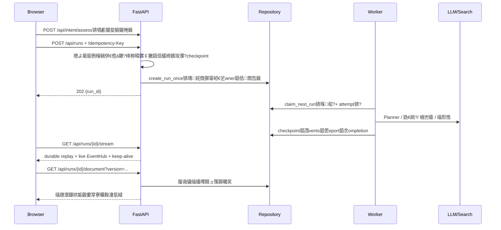

# Deep Research Agent 鍓嶅悗绔笌鐢ㄦ埛浜や簰鍗囩骇鎶€鏈枃妗?

**瀹℃煡鏃ユ湡**锛?026-10-16  
**浠ｇ爜鍩虹嚎**锛歚main`锛宍ed97c2772fac0e9540541cd4398ad27e5f193e56` 鍙婂綋鍓嶅伐浣滄爲鏈彁浜や慨鏀? 
**瀹℃煡鑼冨洿**锛欶astAPI API銆佷换鍔￠槦鍒椾笌鎭㈠銆丼QL/鍐呭瓨浠撳偍銆佽祫鏂欏簱銆佸鏈棶绛斻€丷eact/TypeScript SPA銆丼SE/瀵煎嚭/璇昏€呬氦浜掋€? 
**璇佹嵁鐩綍**锛歔绂荤嚎鎺㈤拡](review-20261016/probe.py)銆乕鎺㈤拡缁撴灉](review-20261016/probe-results.json)銆乕娴忚鍣ㄦ帰閽圿(review-20261016/browser-probe.spec.ts)銆傛湰鏂囨槸鏈璇勫鎻愭锛屼笉鏀瑰啓 `IMPROVEMENT_PLAN.md` 鐨勫凡鎺ュ彈鎺掓湡銆佸彂甯冪姸鎬佹垨鐢ㄦ埛浜哄伐楠屾敹缁撴灉銆備氦浠樹互鏈枃涓哄噯锛岄澶栧浘璋变笉鍐嶇淮鎶ゃ€?
## 1. 缁撹涓庤竟鐣?

椤圭洰宸茬粡鍏峰涓€濂楀彲杩愯鐨勭鐮斿伐浣滃彴锛岃€屼笉鏄竴涓彧鏈夋绱㈠拰鐢熸垚鎺ュ彛鐨?Demo銆傚悗绔娇鐢?FastAPI銆佸紓姝?SQLAlchemy銆佸唴瀛樹粨鍌?SQLite/PostgreSQL 鍏煎瀹炵幇銆佹寔涔呭寲 checkpoint銆佺绾?fencing銆佷换鍔￠槦鍒椼€丼SE 浜嬩欢鍥炴斁銆佹潵婧愬畨鍏ㄧ瓥鐣ュ拰閫愬瓧璇佹嵁楠岃瘉锛涘墠绔娇鐢?React銆丷eact Query銆佽矾鐢辨噿鍔犺浇銆佷换鍔℃祦閲嶈繛銆侀棶绛旇姹傚箓绛夊拰鏂囨。鐗堟湰鏍￠獙銆傜幇鏈夎嚜鍔ㄦ鏌ヤ笉鑳借瘉鏄庣鐮旂粨璁鸿川閲忋€佺湡瀹炴彁渚涙柟璐圭敤鎴栫敓浜у閲忥紝鏂囨。涓皢杩欎簺涓庡伐绋嬫纭€у垎寮€銆?

鏈瀹℃煡鍦ㄦ湰鍦板畬鎴愶紝娌℃湁杩炴帴瀹為獙瀹ゆ湇鍔″櫒銆佺敓浜ф暟鎹簱鎴栫湡瀹炴ā鍨嬬鐐癸紝涔熸病鏈変慨鏀逛笟鍔′唬鐮併€傛祴璇曚娇鐢ㄥ唴瀛?SQLite銆丠TTP mock銆佸墠绔?jsdom 鍜屽彈鎺?Chromium 椤甸潰锛涗换浣曠敓浜ц涓恒€佹ā鍨嬭川閲忓拰澶?worker 瀹归噺缁撹閮芥爣涓衡€滃皻鏈‘璁も€濄€傚凡闃呰鏍圭洰褰?`CLAUDE.md`銆丷EADME銆佹枃妗ｇ储寮曘€佸綋鍓嶆敼杩涜鍒掑強杩戞湡闂瀹℃煡璁板綍锛涙湭鍙戠幇鐙珛鐨勯」鐩蹇?浜ゆ帴鏂囦欢銆俙.env`銆佽繍琛屾暟鎹簱鍜岀湡瀹炲嚟鎹湭璇诲彇銆?
### 宸查獙璇佺殑宸ョ▼鑳藉姏

| 鑳藉姏 | 浠ｇ爜璇佹嵁 | 楠岃瘉缁撴灉 |
| --- | --- | --- |
| API 閴存潈涓庡綊灞為殧绂?| `deep_research/http/auth.py` 鐨?`require_api_key`锛沗api.py` 鐨?owner 鏍￠獙 | 鍚庣璁块棶鎺у埗鐩稿叧娴嬭瘯閫氳繃 |
| 鎸佷箙鍖栭槦鍒椼€佸箓绛夈€佺绾?| `api.py` `_enqueue_run`锛沗persistence/sql_repository.py` `create_run_once`/`claim_next_run` | 闃熷垪涓庢湇鍔″崗璋冩祴璇曢€氳繃 |
| 璺ㄨ繘绋?SSE 鍥炴斁 | `deep_research/http/sse.py` `_stream_run_sse` | SSE/鎭㈠娴嬭瘯閫氳繃锛涘惈 Last-Event-ID銆乤ttempt 鍥炵粫鍜?durable tail |
| 闂瓟鏂嚎鎭㈠ | `frontend/src/lib/qaRequest.ts` `runQaRequest`锛沗workbench/qa_api.py` | 闂瓟鎭㈠娴嬭瘯閫氳繃 |
| 鍓嶇鏋勫缓涓庢牳蹇冮〉闈?| `frontend/package.json`銆佽矾鐢?lazy銆丷eact Query | `npm run build` 鎴愬姛锛涢€夊畾 66 椤瑰墠绔祴璇曢€氳繃 |
| 鍚庣绫诲瀷涓庨潤鎬佹鏌?| `pyproject.toml`銆丆I workflow | `ruff check`銆乣mypy deep_research` 鎴愬姛锛涢€夊畾 174 椤瑰悗绔祴璇曢€氳繃 |

### 褰撳墠楂樹紭鍏堢骇闂

| 浼樺厛绾?| 闂 | 褰卞搷 | 澶嶇幇璇佹嵁 |
| --- | --- | --- | --- |
| P1 | **妯℃澘璇锋眰鐨勫箓绛夐噸璇曚細杩斿洖 409**锛氱涓€娆℃彁浜ゆ垚鍔燂紝浣跨敤鍚屼竴 `Idempotency-Key` 閲嶈瘯琚涓鸿姹備綋涓嶅悓 | 缃戠粶瓒呮椂鍚庣殑瀹夊叏閲嶈瘯浼氬埗閫犵敤鎴疯瑙ｏ紱瀹㈡埛绔棤娉曠煡閬撳師浠诲姟鏄惁宸插垱寤?| `probe-results.json` `template_retry`: `first=202`銆乣retry=409`锛涘叆鍙ｅ厛璁＄畻 `_run_request_hash`锛屾ā鏉?绛栫暐闅忓悗鏀瑰啓 `req` 鍚庡張鍦?`_enqueue_run` 璁＄畻涓€娆?|
| P1 | **鍒犻櫎浠诲姟浼氳繑杩樻瘡鏃ョ爺绌堕搴?* | 鐢ㄦ埛鍙€氳繃鍒涘缓銆佸垹闄ゅ惊鐜粫杩?`DAILY_RUN_QUOTA`锛涚敤閲忎笌瀹¤璁板綍涓嶅啀鏄崟璋冪殑 | `usage.py` 浠庡綋鍓?`research_run` 姹囨€伙紱`delete_run` 绾ц仈鍒犻櫎锛涙帰閽?`quota_delete` 涓?`1 鈫?0` |
| P1 | **璇︽儏浜嬩欢榛樿鍙鏈€鍓?2000 鏉?*锛岃川閲忔寚鏍囦粠鎴柇浜嬩欢璁＄畻 | 鍚庣画 `source_policy` 鎷︽埅鏁颁粠璇︽儏鎸囨爣娑堝け锛涜繍琛屾€?token 鏈夌嫭绔嬪瓧娈碉紝鏈帰閽堟病鏈夎瘉鏄?token 婕忚 | `api.py` `_RUN_DETAIL_EVENT_LIMIT=2000`銆乣_enrich_run_detail`锛涙帰閽堝瓨 2001 鏉″苟鎶婃嫤鎴斁鍦ㄧ 2001 鏉★紝`blocked_sources=0` 鑰岄鏈熶负 7 |
| P1 | **鍒犻櫎浠诲姟涓嶅垹闄ょ粦瀹氱殑闂瓟浼氳瘽** | 宸茬煡浼氳瘽 URL 浠嶅彲璇诲彇浠诲姟涓婁笅鏂囩殑闂瓟璁板綍锛涙暟鎹簱鍑虹幇鏃犱富浼氳瘽鍜屾晱鎰熸潗鏂欐畫鐣?| `QaConversationRow.run_id` 鍙槸鍙┖瀛楃涓茬储寮曪紝娌℃湁 FK锛涙帰閽堝垹闄?run 鍚?`still_readable=true` |
| P2 | **`get_project` 閫氳繃 `list_projects()` 鎵弿鎵€鏈夐」鐩?* | 椤圭洰鏁板闀垮悗姣忔鏉冮檺妫€鏌ラ兘鍋氬叏琛ㄨ仛鍚堬紱闈炵鐞嗗憳璇锋眰涔熷厛鍔犺浇鍏朵粬绉熸埛鐨勯」鐩璞★紝HTTP 灞備粛浼氭牎楠屽綊灞烇紝娌℃湁璇佹槑璺ㄧ鎴峰搷搴旀硠闇?| `library/repository.py` SQL `get_project`锛涙帰閽?SQL 鍙湁涓€娆℃煡璇笖鏃?`WHERE` |
| P2 | **闂瓟浼氳瘽鍒楄〃鍥哄畾 `.limit(200)`锛屾病鏈?cursor/page 濂戠害** | SQL 鍙繑鍥?200 鏉★紝鍐呭瓨瀹炵幇杩斿洖鍏ㄩ儴锛屽垏鎹㈠瓨鍌ㄥ悗琛屼负涓嶄竴鑷达紱鑰佷細璇濇棤娉曢€氳繃 UI 缈婚〉 | `workbench/qa_store.py` SQL `list`锛涙帰閽?`sql_list=200`銆乣memory_list=201` |
| P1 | **涓婁竴璇锋眰澶辫触浼氳鐩栨鍦ㄧ紪杈戠殑鏂拌崏绋?* | 绛夊緟绗竴闂椂鍙緭鍏ョ浜岄棶锛涚涓€闂繜鍒扮殑閿欒鎶婄浜岄棶鏇挎崲涓虹涓€闂?| `QaPage.tsx` `onError: setDraft(text)`锛涚湡瀹?Chromium 鍙楁帶 422 鍝嶅簲宸插鐜?|
| P2 | **绂诲紑闂瓟椤典細涓㈠け鏈彂閫佽崏绋?* | 鏌ヨ璧勬枡鎴栦换鍔¤褰曞悗杩斿洖锛岄渶瑕侀噸鏂拌緭鍏ワ紱pending request 淇濆瓨涓嶈兘淇濇姢鏈彂閫佸唴瀹?| `QaWorkspace` 浣跨敤灞€閮?`useState('')`锛涙祻瑙堝櫒璺ㄨ矾鐢辨帰閽堝凡澶嶇幇 |
| P2 | **璧勬枡搴撳厛鍙栨渶鏂?5000 鍧楋紝鍐嶅湪 Python 鍐呮帓搴?* | 绗?5001 鍧楀強浠ュ悗鍗充娇鏈€鐩稿叧涔熸棤娉曞彫鍥烇紝涓旀瘡涓煡璇㈤兘閲嶅鍒嗚瘝涓庤瘎鍒?| `SqlLibraryRepository.search_chunks` 鎺掑簭/limit锛沗ProjectCorpusSearch.search` 鍏堝彇鍧楀悗 `_rank_chunks`锛屾簮鐮佺‘瀹氱殑鑼冨洿闄愬埗锛屾湭鍋氱敓浜ц妯″帇娴?|
| P2 | 璇︽儏銆佹搷浣滅粺璁″拰鎶ュ憡瑁呴厤鍚勮嚜璇诲彇浜嬩欢涓婇檺锛屾寚鏍?瀵煎嚭/椤甸潰鍙兘鍑虹幇涓嶅悓瑙嗗浘 | 鐢ㄦ埛鐪嬪埌鐨勬姤鍛婃暟瀛椼€佷换鍔¤鎯呮暟瀛楀拰鎿嶄綔鍙版眹鎬婚毦浠ュ璐?| `api.py` `_RUN_DETAIL_EVENT_LIMIT`銆乣_DOCUMENT_EVENT_LIMIT` 涓?`operations_source.py` 鍒嗗埆瀹氫箟璇诲彇杈圭晫 |
| P2 | API 璺敱銆丳ydantic 杈撳叆銆佸惎鍔ㄧ敓鍛藉懆鏈熶粛闆嗕腑鍦ㄧ害 3000 琛岀殑 `api.py` | 淇敼璺敱銆侀壌鏉冦€侀槦鍒楀拰瀵煎嚭鏃跺鏄撳舰鎴愰殣寮忚€﹀悎锛涙祴璇?fixture 闇€瑕佹墜鍔ㄨ閰嶅ぇ閲?`app.state` | `api.py` 瀹為檯涓烘渶澶?Python 鏂囦欢锛汣I 宸叉湁璺敱绾ф祴璇曚絾缂哄皯杈圭晫妯″潡鍖栫害鏉?|
| P2 | 璺敱宸叉湁娓叉煋閿欒鍏滃簳锛屼絾澶嶆潅瀛愰潰鏉跨己灏戠嫭绔嬬殑閿欒鎭㈠杈圭晫 | 鍗曚釜鍙€夐潰鏉垮嚭閿欏彲浣挎暣鏉¤矾鐢辫繘鍏?ErrorPage锛涘綋鍓嶆病鏈夊彂鐜版棤閿欒杈圭晫瀵艰嚧鐧藉睆鐨勮瘉鎹?| `main.tsx` `errorElement`銆乣pages/ErrorPage.tsx`锛涘眬閮ㄩ殧绂诲睘浜庡寮洪」 |
| P2 | 鍓嶇 bundle 鐨勫ぇ鍨?Markdown/PDF 璧勬簮浠嶈緝閲?| 棣栨宸ヤ綔鍙板姞杞藉彈缃戠粶鍜屼綆绔澶囧奖鍝嶏紱鏋勫缓浜х墿鍚害 425 KB markdown銆?82 KB PDF worker锛坓zip 鍓嶏級 | `npm run build` 杈撳嚭锛涢〉闈㈠凡 lazy锛涜繖浜涗綋绉笉鏄灞忓疄浼犳€婚噺锛岄渶娴忚鍣ㄤ緷璧栭摼娴嬮噺鍚庡喅瀹氭媶鍒?|

鍏辩‘璁?8 椤硅涓猴紙6 椤瑰悗绔绾挎帰閽堛€? 椤规祻瑙堝櫒浜や簰鎺㈤拡锛夛紱璧勬枡搴撳彫鍥炴埅鏂负婧愮爜纭鐨勮璁￠檺鍒讹紝鍚庨潰鐨勭粨鏋?鎬ц兘椤规槸宸ョ▼椋庨櫓鍜屽寮哄缓璁€備紭鍏堢骇鍚箟锛歅1 涓烘槑鏄炬崯瀹宠姹備竴鑷存€с€佸垹闄よ涔夈€侀搴︽垨鐢ㄦ埛杈撳叆鐨勭己闄凤紱P2 涓鸿妯°€佸彲缁存姢鎬ф垨浣撻獙鏀瑰杽銆傛病鏈夎冻澶熻瘉鎹绉板瓨鍦?P0 绾т簨鏁呫€?
## 2. 褰撳墠绯荤粺鏋舵瀯

```mermaid
flowchart LR
  U[鐮旂┒鑰?璁垮] --> SPA[React SPA\n璺敱鎳掑姞杞?+ React Query]
  SPA -->|JSON/涓嬭浇| API[FastAPI API]
  SPA -->|SSE + Last-Event-ID| SSE[SSE stream]
  API --> AUTH[API key / Principal]
  API --> INTENT[鎰忓浘璇勪及涓庢緞娓匽
  API --> QUEUE[鎸佷箙鍖栧叆闃焅n骞傜瓑/瀹归噺/绉熺害]
  QUEUE --> WORKER[Inline Worker 鎴栫嫭绔?Worker]
  WORKER --> EXEC[RunExecutor]
  EXEC --> WF[Workflow / DAG / checkpoint]
  WF --> AGENTS[Planner / Researcher / Reflector / Synthesizer]
  AGENTS --> SEARCH[缃戦〉/瀛︽湳/璧勬枡搴撴绱
  AGENTS --> GUARD[鏉ユ簮绛栫暐 + 璇佹嵁閫愬瓧楠岃瘉]
  GUARD --> REPO[(SQL/Memory Repository)]
  EXEC --> REPO
  REPO --> SSE
  REPO --> REPORT[ReportService / 瀵煎嚭 / 浜や粯鍥炴墽]
  SPA --> REPORT
```

### 鐢ㄦ埛鍔ㄤ綔鍒扮粨鏋滅殑涓婚摼



### 鏁版嵁鍏崇郴涓庣敓鍛藉懆鏈?

`research_run` 鏄换鍔℃牴锛沗workflow_run` 淇濆瓨鎵ц瀹氫箟銆乧heckpoint銆乤ttempt 鍜?lease锛沗event` 淇濆瓨鏈夊簭浜嬩欢锛沗research_result`/`finding`/`source` 淇濆瓨鐮旂┒璇佹嵁锛沗report` 淇濆瓨鎶ュ憡锛沗run_tag` 淇濆瓨鏍囩銆俙research_project 鈫?corpus 鈫?library_source 鈫?source_chunk` 鏄鏈夎祫鏂欏簱閾俱€俙qa_conversation 鈫?qa_message 鈫?qa_stream_event` 鏄棶绛旈摼锛岀洰鍓?`qa_conversation.run_id` 娌℃湁鏁版嵁搴撳閿紝鍥犳浠诲姟鍒犻櫎涓嶄細鑷姩娓呯悊缁戝畾浼氳瘽锛岃繖鏄?P1 闂銆?

褰撳墠鐘舵€併€乧heckpoint銆佹墽琛岀粨鏋溿€佷簨浠跺璁″拰鎶ュ憡鎶曞奖宸茬粡鍒嗗紑锛岃繖鏄彲闈犳€у熀纭€銆傚崌绾у簲缁х画淇濇寔杩欎竴杈圭晫锛屼笉鎶娾€滄渶鏂版姤鍛?Markdown鈥濆綋浣滀簨浠跺璁℃垨璁¤垂鐢ㄩ噺鏉ユ簮銆?

## 3. 鍓嶇涓庣敤鎴蜂氦浜掑鏌?

### 宸叉湁浼樼偣

1. `main.tsx` 浣跨敤 React Router 鐨?route lazy锛宍RunPage` 涓?`ReaderPage` 鎸夐渶鍔犺浇锛汸DF viewer 鍜屽尯鍩熼€夋嫨鍣ㄨ繘涓€姝?lazy锛屽噺灏戦灞忎唬鐮併€?
2. `useResearchStream` 澶勭悊 token 鍚堝苟銆佺粓鎬併€侀噸杩炲拰鏂嚎鐘舵€侊紱`client.ts` 鍙戦€?`Last-Event-ID`锛孲SE 瀹㈡埛绔湁 45 绉?idle deadline 鍜屾渶澶х紦鍐蹭繚鎶ゃ€?
3. `runQaRequest` 浠ョǔ瀹?request ID 鏌ヨ鏈嶅姟绔姸鎬侊紝鏂嚎鍚庡厛 GET 鍘熻姹傦紝閬垮厤鎸夐棶棰樻枃鏈寽娴嬫槸鍚﹂噸澶嶆彁浜わ紱鍓嶇涔熶繚瀛?pending request锛屽埛鏂板悗鍙仮澶嶃€?
4. React Query key 鎸?run銆乸roject銆乧onversation 闅旂锛涚櫥褰曞け鏁堜細娓呯悊缂撳瓨鍜屾湰鍦拌崏绋匡紝鍑忓皯璺ㄨ韩浠芥硠闇层€?
5. 浠诲姟椤典紭鍏堜娇鐢ㄦ寔涔呭寲缁撴瀯鍖栨枃妗ｏ紝鎭㈠浠诲姟浼氫娇鏃ф枃妗ｇ紦瀛樺け鏁堬紱瀵煎嚭甯?content version锛屾湇鍔＄鎷掔粷鐗堟湰杩囨湡涓嬭浇銆?

### 浜や簰闂涓庡崌绾ф柟鍚?

| 鍦烘櫙 | 褰撳墠琛屼负 | 寤鸿 |
| --- | --- | --- |
| 鐮旂┒鎻愪氦瓒呮椂 | 瀹㈡埛绔彲閲嶈瘯锛屼絾 P1 骞傜瓑鍝堝笇鍐茬獊浼氭妸瀹夊叏閲嶈瘯鏄剧ず涓?409 | 鏈嶅姟绔湪鈥滆鑼冨寲璇锋眰鈥濅箣鍚庝竴娆℃€х敓鎴?hash锛屽苟鎶婅鑼冨寲璇锋眰鍐欏叆鍒濆 checkpoint锛涢噸澶?key 杩斿洖鍚屼竴 run |
| 杩愯璇︽儏闀夸簨浠?| 椤甸潰浜嬩欢鍒楄〃鏈変笂闄愶紝鎸囨爣浠庡悓涓€鎴柇鍒楄〃璁＄畻 | 璇︽儏杩斿洖 `events_summary` 鍜?`events_cursor`锛涙寚鏍囧彧浠庤仛鍚堝瓧娈垫垨鐙珛瀹¤鏌ヨ璁＄畻 |
| 闂瓟鍘嗗彶澧為暱 | SQL 200 鏉＄‖鎴柇锛屼細璇濆垪琛ㄦ病鏈夆€滃姞杞芥洿澶氣€?| 澧炲姞 `cursor`/`limit`锛屽墠绔樉绀烘€绘暟銆佸姞杞芥洿澶氬拰鈥滄柊浼氳瘽鈥濆叆鍙ｏ紱鍐呭瓨瀹炵幇澶嶇敤鍚屼竴鍒嗛〉鍗忚 |
| 椤甸潰娓叉煋寮傚父 | 鏍硅矾鐢?`errorElement` 鑳芥崟鑾峰瓙璺敱娓叉煋寮傚父骞舵樉绀?`ErrorPage` | 浠呭湪鍙€?PDF/鍥捐〃/宸ヤ綔娴侀潰鏉垮鍔犲眬閮ㄨ竟鐣岋紱淇濈暀鐜版湁璺敱杈圭晫锛屽紓姝ラ敊璇户缁敱 query/mutation 澶勭悊 |
| 璧勬枡搴撻」鐩€夋嫨 | 鍓嶇鎸夐」鐩?璧勬枡搴撳垎灞傛煡璇紝鍚庣鏉冮檺妫€鏌ヤ細鍏ㄨ〃鎵弿 | 鍚庣鎸?ID 鏌ヨ骞跺湪 SQL 涓悓鏃剁害鏉?owner锛涘墠绔繚鐣欏綋鍓嶉€夋嫨锛?04 鏃舵竻鐞嗛€夋嫨骞舵彁绀?|
| 绉诲姩绔暱浠诲姟 | 宸叉湁鎶藉眽銆佸搷搴斿紡 CSS 鍜屾祦寮忕姸鎬?| 澧炲姞鈥滆繛鎺ョ姸鎬?涓婃鏇存柊鏃堕棿鈥濆彲瑙佹彁绀恒€佹柇绾垮悗鐨勬墜鍔ㄩ噸杩炴寜閽拰鍑忓皯鍔ㄧ敾閫夐」 |

## 4. 鐩爣鏋舵瀯涓庡疄鐜版柟妗?

### 4.1 瑙勮寖鍖栬姹備笌骞傜瓑锛圥1锛?

寮曞叆 `NormalizedRunRequest`锛屽湪 `create_run` 鏈€鍓嶉潰瀹屾垚浠ヤ笅姝ラ锛?

搴斿垎寮€淇濆瓨鈥滄彁浜ゅ唴瀹光€濅笌鈥滃凡瑙ｆ瀽鎵ц杈撳叆鈥濓紝涓嶈璁╁箓绛変緷璧栦細鍙樺寲鐨勮繍琛岄厤缃€傛渶灏忎慨澶嶅厛鍦?`create_run` 浠讳綍 `model_copy(update=...)` 涔嬪墠璁＄畻涓€娆＄幇鏈?`_run_request_hash(req)`锛屽悗缁€氳繃宸叉湁 `request_hash` 鍙傛暟浼犲埌 `_submit_prepared_run` 鍜?`_enqueue_run`銆傝繖鑳戒慨澶嶅綋鍓嶉噸澶嶅搱甯岀殑闂锛屼笖鏃犻渶绔嬪嵆杩佺Щ schema銆?
瀹屾暣璁捐浣跨敤涓や釜涓嶅彲鍙樺璞★細`SubmittedRunRequest` 鍜?`ResolvedRunSpec`銆傚墠鑰呭彧渚濇嵁鐢ㄦ埛鎻愪氦鍐呭鍜屽浐瀹氱殑鍗忚鐗堟湰璁＄畻 hash锛涘悗鑰呭寘鍚ā鏉?绛栫暐/瑙掕壊蹇収銆佹湁鏁?settings銆佹墽琛屽畾涔夊苟鍗曠嫭璁＄畻 execution hash銆傞噸澶嶈姹傚繀椤诲厛鏌ユ彁浜?hash锛屽懡涓氨杩斿洖鍘嗗彶 run锛屼笉閲嶆柊瑙ｉ噴浠婂ぉ鐨勬ā鏉块粯璁ゅ€笺€?
1. 鎸?Pydantic 鏍￠獙鎻愪氦鏍煎紡锛屼繚鐣欐湁璇箟鐨勬暟缁勯『搴忥紙attachments/history锛夊拰鐢ㄦ埛鏂囨湰锛汮SON 瀵硅薄閿帓搴忥紝涓嶆帓搴忔墍鏈夊垪琛ㄣ€?2. 闄勪欢褰撳墠鐢卞鎴风鎻愪氦瑙ｆ瀽鍐呭锛屼笉鑳戒粎鐩镐俊瀹㈡埛绔?`file_sha256`銆傜幇闃舵淇濈暀鏁翠釜宸叉牎楠岄檮浠舵暟鎹繘鍏?hash锛涙湭鏉ユ湇鍔″櫒鎸佹湁涓婁紶璁板綍鏃讹紝鎵嶆浛鎹负缁忚繃褰掑睘鏍￠獙鐨?attachment ID + 鏈嶅姟绔憳瑕併€?3. hash 涓嶅寘鎷綋鍓嶆椂闂淬€乴ease owner銆佸疄鏃堕厤缃拰鍑嵁锛涙槑纭?`request_hash_version`銆傛彁浜?hash 鍛戒腑鏃讹紝鍗充娇鏈嶅姟绔厤缃彉鏇翠篃搴旇繑鍥炲師浠诲姟銆?4. 鏈懡涓墠瑙ｆ瀽妯℃澘銆亀orkflow銆乼ier 涓庢暟鎹紝褰㈡垚 `ResolvedRunSpec`锛屾墽琛岃鑼冨喕缁撹繘 checkpoint銆?5. 鍏ラ槦浜嬪姟淇濆瓨鍘熷鎻愪氦 hash锛屽苟缁х画鐢卞敮涓€绾︽潫澶勭悊骞跺彂璇锋眰銆?
浼唬鐮侊細

```python
submitted = validate_submitted_request(req)
request_hash = hash_submitted_v2(submitted)  # 涓嶄緷璧栧綋鍓?settings
existing = await repo.find_run_once(key_for(principal, key), request_hash)
if existing:
    response.headers["Idempotency-Replayed"] = "true"
    return CreateRunResponse(run_id=existing)
resolved = resolve_run_spec(submitted, settings, template_catalog)
execution = create_initial_execution(resolved.effective_query, ...)
await repo.create_run_once(..., request_hash=request_hash, idempotency_key=key)
```

瀵光€滃悓 key銆佷笉鍚屾彁浜も€濈户缁繑鍥?409锛涚浉鍚屾彁浜よ繑鍥炲師 run銆傝鑼冨寲涓嶆槸闅忔剰鎶婁笉鍚岃姹傚綋鎴愮浉鍚岃姹傘€傛柊澧炴祴璇曡鐩栨ā鏉块粯璁ゅ€笺€佹樉寮?workflow銆侀檮浠跺唴瀹?椤哄簭銆乭istory 椤哄簭銆侀厤缃垏鎹€乨ataset source 鍜屽鍓湰骞跺彂銆傚宸蹭繚瀛樻棫寮忔淳鐢?hash 鐨勫巻鍙茶锛屽厛灏濊瘯鏈夌増鏈害鏉熺殑鍏煎鍖归厤锛涙棤娉曡瘉鏄庡悓涓€鎻愪氦鍒欎繚鐣欏啿绐佸苟鎻愮ず鍘嗗彶 run锛屼笉鑳借嚜鍔ㄦ崲 key 鏂板缓銆?
### 4.2 鐢ㄩ噺涓庡璁¤处鏈紙P1锛?

涓嶈鐢ㄥ彲鍒犻櫎鐨?`research_run` 褰撳墠闆嗗悎鎺ㄥ棰濆害銆傛柊澧?append-only `usage_ledger`锛堟垨鍦ㄧ幇鏈?run 涓鍔犱笉鍙彉 `admission_record`锛夛細

```text
usage_ledger(
  id, owner_id, run_id, event_type, created_at_utc,
  request_hash, tokens, status, metadata_json
)
UNIQUE(owner_id, run_id, event_type)
```

`event_type=run_admitted` 鍦?`create_run_once` 鍚屼竴浜嬪姟涓啓鍏ワ紱`run_deleted` 鍙褰曞垹闄わ紝涓嶅啿閿€ `run_admitted`銆俙usage_today` 鏌ヨ `run_admitted`锛屽垹闄ゃ€佸け璐ャ€佹仮澶嶄笉浼氶檷浣庡凡娑堣€楅搴︺€傛洿鍏抽敭鐨勬槸鎶娾€滄鏌ュ墿浣欓搴︹€濅篃绉诲叆璇ヤ簨鍔★細鎸?`(owner_id, UTC day)` 鍙栧緱鍗忚皟閿侊紝骞傜瓑鍛戒腑鍏堣繑鍥烇紱鏂拌姹傛鏌ヨ处鏈€侀鐣欏悕棰濄€佸缓 run 鍚屾椂鎻愪氦銆傚綋鍓?API 鐨勫厛璇诲悗鍐欎篃鏈夊苟鍙戞鏌ョ珵浜夛紝婧愮爜鍙瘉鏄庢病鏈夊師瀛愰搴﹂鐣欙紝浣嗘湰杞湭鍋氫笓闂ㄥ苟鍙戣秴闄愬鐜般€?
杩佺Щ鏈熼棿浠庣幇瀛?`research_run` 鍥炲～涓€娆★紝骞惰褰?`backfill_version`锛岄伩鍏嶉噸澶嶅洖濉€傚凡缁忓垹闄ょ殑鍘嗗彶 run 鏃犳硶鍑┖閲嶅缓锛氫笂绾挎棩淇濈暀鈥滄暟鎹笉瀹屾暣鈥濇爣璁帮紝鎴栨鏃?UTC 璧峰惎鐢ㄥ己棰濆害銆傝处鏈彧淇濈暀璁￠噺 ID/韬唤/鏁板瓧锛屼笉淇濈暀宸插垹闄ょ殑鐮旂┒鏂囨湰銆傝閲忎簨浠朵笉闅忎换鍔?FK 绾ц仈锛涚湡瀹?token 璐︽湰鎸?provider call ID/attempt 鍘婚噸锛屾湭鐭ョ敤閲忕敤 null锛屼笉鑳界敤 0銆?
棰濆害鍝嶅簲澧炲姞 `accounting_source`銆乣as_of` 鍜?`included_statuses`锛岃鐢ㄦ埛鐭ラ亾杩欐槸鈥滃凡鍙楃悊娆℃暟鈥濊€屼笉鏄€滃綋鍓嶅巻鍙插垪琛ㄦ暟閲忊€濄€?

### 4.3 浜嬩欢涓庤川閲忔寚鏍囧垎绂伙紙P1/P2锛?

淇濈暀 `event` 鍏ㄩ噺瀹¤锛屼絾涓哄畨鍏ㄥ拰璐ㄩ噺鎸囨爣澧炲姞鎸佷箙鍖栬仛鍚堬細

```text
run_metric(run_id, attempt, blocked_sources, verified_findings,
           supported_findings, model_calls, total_tokens, updated_at)
```

鐭湡鏃犻渶鏂拌〃锛氫娇鐢ㄥ崟鐙殑鍏ㄩ噺 SQL 鑱氬悎/鍒嗛〉閬嶅巻鍙粺璁?`category=source_policy` 鐨?blocked 鏁帮紱浜嬩欢灞曠ず浠嶉檺 2000锛屽苟杩斿洖 `events_truncated=true`銆傝繖涓慨澶嶅厛娑堥櫎璇鎬ф暟瀛楋紝鍐嶅紩鍏ョ紦瀛樿仛鍚堛€?
闀挎湡姣忔浜嬩欢杩藉姞鍦ㄥ悓涓€浜嬪姟鏇存柊鍙楀奖鍝嶇殑璁℃暟锛涜鎯呮帴鍙ｈ繑鍥炰簨浠堕〉鍜?`events_cursor`锛宍quality_metrics` 璇诲彇鑱氬悎鍊笺€傛姤鍛婅閰嶅拰杩愮淮缁熻浣跨敤鍚屼竴 `MetricSnapshot`銆?*褰撳墠 `save_events` 鏄鐩栧吋瀹规帴鍙ｏ紝涓?seq 鍙鐢?*锛氫粎璁板綍鈥滃鐞嗚繃 seq鈥濅細婕忔帀鏇挎崲鍊笺€傚繀椤诲悓鏃朵繚瀛?`event_generation`锛岃鐩栨椂閲嶇畻瀵瑰簲 generation锛涜拷鍔犳椂浣跨敤 `(run_id,generation,seq)` 鍘婚噸锛屽洖鏀惧彧璇讳笉鍐欒鏁般€傛槑纭?current attempt 涓?lifetime 涓ょ缁熻鍙ｅ緞锛屼笉鑳芥棤鏉′欢鐩稿姞銆傚悗缁嫢鏀逛负 append-only offset锛屽簲鐗堟湰鍖?SSE cursor 骞朵繚鐣欐棫 Last-Event-ID 閫傞厤銆?
### 4.4 浠诲姟涓庨棶绛旂殑绾ц仈鐢熷懡鍛ㄦ湡锛圥1锛?

鎺ㄨ崘灏嗏€滃垹闄や换鍔♀€濆畾涔変负鍒犻櫎鍏剁粦瀹氭潗鏂欎笌闂瓟锛岀嫭绔嬮棶绛斾笉鍙楀奖鍝嶃€傚綋鍓嶆帰閽堣鍒扮殑鏄師 owner 鐨勪細璇濓紝涓嶆槸缁曡繃韬唤楠岃瘉锛涘叿浣撻棶棰樻槸鍒犻櫎璇箟鍜屽巻鍙插叆鍙ｄ笉涓€鑷淬€傚厛鎻愪緵鍙瀛ゅ効娓呭崟锛屾寜浜у搧淇濈暀绛栫暐澶囦唤/褰掓。鍚庡啀娓呯悊锛屼笉鑳借縼绉绘椂闈欓粯鍒犲巻鍙插唴瀹广€備箣鍚庡皢 `qa_conversation.run_id` 鏀逛负 `ForeignKey("research_run.id", ondelete="CASCADE")`锛屽巻鍙茬┖鍊肩户缁唬琛ㄧ嫭绔嬮棶绛斻€傚垹闄?run 鏃讹細

1. 鑾峰彇鍒犻櫎绉熺害锛岄樆姝㈣繍琛屼腑鍒犻櫎銆?
2. 妫€鏌ョ粦瀹氶棶绛斿拰娓叉煋鏄惁浠嶅湪鎵ц銆傛帹鑽愭湁娲昏穬瀛愪换鍔℃椂杩斿洖 409锛岃鐢ㄦ埛鍏堝仠姝紱涓嶈兘浠呮鏌?run 宸茬粓鎬佸氨鍒犻櫎銆傚湪浜嬪姟鍐呭浐瀹氶攣椤哄簭锛坮un 鈫?conversation 鈫?request锛夛紝闃绘妫€鏌ュ悗鍙堝惎鍔ㄦ柊闂瓟銆?3. 鍒犻櫎 run銆亀orkflow銆乪vents銆乻ources銆佹姤鍛娿€侀棶绛斾細璇濆拰娴佷簨浠讹紱ledger 淇濈暀鏈€灏忚閲忚褰曘€?4. 鍐?artifact cleanup 璁板綍锛岀敱鐜版湁 cleanup 鏈哄埗澶勭悊鏂囦欢銆?5. 娓呯悊鍓嶇鎵€鏈夊疄闄呭瓨鍦ㄧ殑 run/conversation 鐩稿叧 query key 鍜?reader PDF cache锛涗笉瑕佸彧 invalidation 鍒楄〃鑰屼繚鐣欏垹闄よ鎯呯紦瀛樸€?
鑻ヤ骇鍝佽姹傗€滀换鍔″垹闄ゅ悗淇濈暀闂瓟鈥濓紝搴旀敼鎴愭樉寮忚劚閽╋細鎶婁細璇濆鍒朵负鐙珛浼氳瘽骞舵竻闄?`run_id` 涓庤鏂囨潗鏂欏紩鐢紝鑰屼笉鑳戒緷璧栧綋鍓嶆棤 FK 鐨勯殣寮忎繚鐣欍€?

### 4.5 璧勬枡搴撴煡璇笌鍙洖杈圭晫锛圥2锛?
涓?`get_project` 浣跨敤鍗曟潯 `SELECT ... WHERE id=:id`锛岄潪绠＄悊鍛樺繀椤诲湪鍚屼竴鏌ヨ鍔犲叆 `owner_id=:owner`锛沗get_source`銆乣get_corpus`銆乣list_chunks` 浣跨敤鐩稿悓妯″紡銆備笉瑕佸厛鍔犺浇鍏ㄩ泦鍐嶅湪 Python 涓瓫閫夈€傛柊澧炵储寮曪細

```sql
CREATE INDEX ix_research_project_owner_updated
  ON research_project(owner_id, updated_at DESC);
-- 鐜版湁 ix_library_source_project_status(project_id,status) 淇濈暀锛涘厛 EXPLAIN 鍐嶅喅瀹氭柊澧炲鍚堢储寮?
CREATE INDEX ix_library_source_project_status_created
  ON library_source(project_id, status, created_at DESC);
```

椤圭洰璇︽儏鎸変富閿煡璇紱濡傛灉 UI 闇€瑕佽鏁帮紝鍒欐寜璇?project ID 瀹氬悜鑱氬悎锛屼笉蹇呮妸鎵€鏈夐」鐩粺璁′竴璧疯繑鍥炪€備互涓婄储寮曟槸鍊欓€?DDL锛岄渶瑕佸厛妫€鏌ュ凡鏈夌储寮曘€丒XPLAIN 涓庡啓鍏ユ垚鏈紝閬垮厤閲嶅寤虹储寮曘€?
妫€绱㈤棶棰樹笉鏄妸 5000 鍏ㄩ儴閫佹ā鍨嬶紙鐜版湁浠ｇ爜宸插彧杩斿洖鍓嶅嚑涓浉鍏冲潡锛夛紝鑰屾槸**鎺掑簭鍓嶅€欓€夐泦鍚堝凡缁忔埅鏂?*銆傚簲鏂板 `search_candidates(project_id, owner_id, query, limit)`锛氬厛浠?tenant/project/status 杩囨护锛屽啀鍦ㄦ暟鎹簱鎼滅储鍏ㄩ」鐩唴瀹癸紝杩斿洖鏈€澶氱害 200 涓€欓€夛紝鐢卞凡鏈?`_rank_chunks` 鍜?`_select_diverse` 閲嶆帓銆係QLite 鍙敤 FTS5锛孭ostgreSQL 鍙敤鍏ㄦ枃绱㈠紩锛涗腑鏂囪鏄庣‘鍒嗚瘝/鍙屽瓧 token 绛栫暐锛屼笉鑳界洿鎺ュ亣璁捐嫳鏂囪瘝骞插櫒閫傜敤銆傜储寮曟寜 source hash/瑙ｆ瀽鐗堟湰澧為噺鏇存柊锛宔xcluded/delete 蹇呴』鍚屾澶辨晥銆備笂绾垮墠鍏堢敤鍥哄畾鏌ヨ闆嗘瘮瀵规棫瀹炵幇锛岄獙璇佲€滅浉鍏冲唴瀹瑰彧鍑虹幇鍦ㄧ 5001 鍧椻€濆彲鍙洖锛屽啀娴?p95 鍜?CPU銆?
鍒楄〃灞曠ず涓庢绱㈡帴鍙ｅ垎寮€锛氬垪琛ㄤ娇鐢?cursor锛屾绱娇鐢?query + top-k锛屼笉鎶婂垪琛ㄥ垎椤靛綋鎼滅储淇銆傛湭瀹屾垚绱㈠紩鍗囩骇鍓嶈繑鍥?`candidate_truncated` 鍜岃鐩栨暟閲忥紝鍦?UI 鏄庣‘璧勬枡搴撳彧妫€绱簡閮ㄥ垎鐗囨銆?
### 4.6 API 妯″潡鍖栦笌閿欒濂戠害锛圥2锛?

鍏堝鐢ㄧ幇鏈?`http/` 鍖呮媶鍒嗕负 `http/routes/{health,runs,documents,config}.py`銆乣http/schemas/`锛屼繚鐣欑幇鏈?`workbench/qa_api.py`銆乣library/api.py`銆乣catalog_api.py`銆備笉瑕佸悓鏃跺垱寤?`api/` 鍖呭拰淇濈暀 `api.py` 瀵艰嚧瀵煎叆姝т箟銆俙api.py` 鏈€缁堝彧璐熻矗 `create_app`銆乴ifespan銆乵iddleware 鍜屽吋瀹瑰鍑猴紝淇濇寔 `deep_research.api:app`銆傛妸 `_check_rate_limit` 绛夊叡浜緷璧栫Щ鍏?`http/`锛屽幓鎺?QA 瀵?`from .. import api as api_module` 鐨勫洖寮曪紱娴嬭瘯閫愭浣跨敤 `create_app(dependencies)`锛屼繚鐣欐棫娴嬭瘯鐨勫吋瀹规敞鍏ョ偣鐩磋嚦杩佸畬銆?
缁熶竴閿欒缁撴瀯锛?

```json
{
  "code": "idempotency_conflict",
  "message": "璇ヨ姹傛爣璇嗗凡鐢ㄤ簬鍙︿竴浠借姹?,
  "request_id": "...",
  "retryable": false,
  "details": {}
}
```

鍓嶇 `ApiError` 淇濆瓨 `code`銆乣requestId`銆乣retryable`锛屾寜閿欒鐮佸喅瀹氣€滈噸璇曘€佺櫥褰曘€佷慨鏀硅緭鍏ユ垨鑱旂郴绠＄悊鍛樷€濓紝閬垮厤鍙妸浠绘剰瀵硅薄鎷兼帴鎴愬瓧绗︿覆銆?

### 4.7 鍓嶇鍙潬鎬т笌鎬ц兘锛圥2锛?

1. 淇濈暀璺敱 ErrorPage锛屽湪 PDF銆佸浘琛ㄧ瓑鍙€夐潰鏉垮鍔犲眬閮?Error Boundary锛汬TTP 閿欒灞曠ず request ID锛岀函娓叉煋閿欒浣跨敤鍗曠嫭鐨勫墠绔?incident ID銆?
2. 缁熶竴 `queryKeys` 宸ュ巶锛屾秷闄?QA 椤甸潰 `['qa-conversations', runId]` 涓庨槄璇婚〉 `['qa-conversations','run',id]` 鐨勫悓鏁版嵁涓嶅悓 key銆傝韩浠介殧绂诲彲閫愭澧炲姞 principal 鍛藉悕绌洪棿锛屼絾淇濈暀褰撳墠閫€鍑烘竻绌烘墍鏈夌紦瀛樺拰 PDF 缂撳瓨鐨勫畨鍏ㄨ涓猴紱涓嶅瓨鍦ㄤ粎鍑姞鍏?key 鍓嶇紑灏卞彲鍋滄娓呯悊鐨勪緷鎹€?3. 瀵瑰巻鍙蹭换鍔″拰闂瓟閲囩敤 cursor 鍒嗛〉锛涘ぇ浜嬩欢鍒楄〃浣跨敤绐楀彛鍖栨垨鈥滄渶杩?200 + 鍔犺浇鏇存棭鈥濄€?
4. 灏?Markdown銆丳DF worker銆亀orkflow canvas 浠庡叕鍏卞叆鍙ｇ户缁媶鍑猴紝鏋勫缓闂ㄧ璁板綍 initial JS gzip銆佹渶澶?route chunk 鍜?PDF 璧勬簮澶у皬銆?
5. SSE 澧炲姞鈥滄渶鍚庝簨浠舵椂闂淬€佸凡閲嶈繛娆℃暟銆佹仮澶嶆潵婧愶紙live/replay锛夆€濈殑闈炴晱鎰熺姸鎬侊紱鐢ㄦ埛鍙墜鍔ㄩ噸鏂拌繛鎺ワ紝浣嗕笉鑳介噸澶嶅垱寤轰换鍔°€?
6. 瀵?composer銆佷笂浼犮€佸鍑哄拰鍒犻櫎鍔ㄤ綔缁熶竴浣跨敤鍙搷浣滈敊璇潰鏉匡紱閲嶅ぇ鍒犻櫎鐨勭‘璁ゅ簲灞曠ず褰卞搷鐨勪細璇?浜х墿鏁伴噺銆傜幇鏈夊師鐢?confirm 鏈韩涓嶆槸缂洪櫡锛屼笉蹇呬负浜嗙粍浠舵暟閲忔浛鎹㈠畠銆?
### 4.8 鑽夌銆佽姹傚拰鍥炵瓟鍒嗗埆绠＄悊锛圥1/P2锛?
**娴忚鍣ㄥ凡澶嶇幇**锛氬凡鍙戦€?A锛岀瓑寰呮椂杈撳叆 B锛孉 鏀跺埌 422 鍚?`onError(_error,text)` 鎵ц `setDraft(text)`锛孊 琚浛鎹€傜寮€ QA 璺敱鍚庤繑鍥炴湭鍙戦€佹枃鏈篃涓虹┖銆俁eaderPage 鏈夌浉浼肩姸鎬侀€昏緫锛屽簲澶嶇敤淇鏂规骞跺崟鐙洖褰掞紝涓嶆妸 QA 瀹炴祴褰撲綔 Reader 瀹炴祴銆?
瀹炵幇 `useQaSession`锛屽垎鍒淮鎶や笁绫荤姸鎬侊細

```ts
type Draft = { text: string; editRevision: number; updatedAt: number }
type Submission = { requestId: string; text: string; draftRevision: number; scope: QaScope }
type RequestPhase = 'submitting' | 'streaming' | 'reconnecting' | 'stopping' | 'settled'
```

- submit 鏃朵繚瀛?Submission锛屽啀娓呯┖杈撳叆骞跺鍔?editRevision銆傛湡闂寸敤鎴峰彲浠ョ紪杈戜笅涓€闂€?- 鍑洪敊鍙皢 Submission 鏄剧ず涓哄彲閲嶈瘯鐨勨€滀笂涓€闂€濓紝涓嶅緱瑕嗙洊褰撳墠 Draft锛涜嫢浠嶄负绌轰笖 revision 鏈彉鍖栵紝鍙互鎭㈠鍘熸枃锛岀敤鎴风紪杈戝悗缁濅笉鎭㈠瑕嗙洊銆?- 浣跨敤鍚屼竴浼氳瘽/鏂颁細璇濅复鏃?ID 鐨勮崏绋垮簱锛岄粯璁?sessionStorage锛屽皬鑼冨洿淇濆瓨鏂囨湰涓?scope锛屼笉瀛樺嚟鎹拰鍘熸枃闄勪欢锛?00ms 闃叉姈锛屽垏鎹㈣矾鐢变富鍔?flush锛屾寜韬唤+浼氳瘽鍒嗗尯骞跺湪鐧诲嚭娓呯悊銆?- 棣栨闂瓟鍒涘缓浼氳瘽鍚庢妸涓存椂鑽夌 key 杩佺Щ涓虹湡瀹?cid锛沗navigate('/qa/{cid}')` 涓嶈兘閲嶇疆宸茶緭鍏ョ殑涓嬩竴闂€?- 淇濈暀褰撳墠 `pendingQaId`/`runQaRequest` 瀵瑰凡鍙戦€佽姹傜殑鎭㈠锛屼笉鎶婃湭鍙戦€佽崏绋胯嚜鍔?POST銆?- 閿欒鎭㈠鎸夐挳澶嶇敤鏃?request ID锛堣嫢鏈嶅姟绔凡鍙楃悊锛夛紱涓氬姟 422 鍚庝慨鏀硅緭鍏ュ垯鐢熸垚鏂?ID銆傚仠姝㈠彧璋冪敤褰撳墠 activeRequestId锛屽叧闂〉闈粎鏂繛鎺ャ€?
楠屾敹鑷冲皯瑕嗙洊锛氱瓑寰呬腑缂栬緫鍚庢垚鍔?澶辫触銆侀闂鑸€佷細璇濆垏鎹€佸埛鏂般€佸瓨鍌ㄧ鐢ㄣ€佷笉鍚岃韩浠姐€佽繜鍒拌姹傚拰 IME Enter銆傜晫闈繚鐣欑幇鏈?isComposing 闃叉姢锛屼笉鑳芥妸鈥滃凡鏀寔涓枃杈撳叆鈥濆啓鎴愭柊澧炲姛鑳姐€?
### 4.9 闂瓟鍒嗛〉涓庨暱鍐呭锛圥2锛?
鏂板 `GET /api/qa/conversations?limit=30&cursor=...` 杩斿洖 `{items,next_cursor,has_more}`锛屾父鏍囧寘鍚?`(updated_at,id)`锛屾煡璇笌鎺掑簭鍚屾椂浣跨敤涓ゅ瓧娈碉紝閬垮厤鍚屼竴鏃堕棿鎴抽噸澶?閬楁紡銆傞渶瑕佽縼绉诲吋瀹规椂鍏堝鍔?`/page` 璺緞鎴栧崗鍟嗗搷搴旂増鏈紝涓嶈兘鐩存帴鎶婄幇鏈夋暟缁勫搷搴旀浛鎹㈡垚瀵硅薄銆傞壌鏉冨悗鍙繑鍥炲綋鍓?owner 鎴栫鐞嗗憳鑼冨洿锛汳emory/SQL 鍏辩敤 cursor 缂栬В鐮佷笌琛屼负娴嬭瘯銆?
浼氳瘽璇︽儏褰撳墠涓€娆″姞杞藉叏閮ㄦ秷鎭紙涓婇檺 200锛夛紝鐢熸垚涓?5 绉掕疆璇㈡暣涓細璇濓紱娑堟伅鍙兘鍚暱姝ｆ枃銆乪vidence 鍜?thoughts銆傛柊澧?`messages?before_position&limit`锛岄娆″彧鍔犺浇鏈€杩戞秷鎭紝鐢熸垚涓殑璇锋眰鐘舵€佺户缁敤杞婚噺 request endpoint锛沗runQaRequest` 鐨勫畬鏁?terminal message 鎴愪负鏇存柊婧愩€傛姌鍙犲巻鍙叉帹鐞?鏍搁獙璁板綍骞舵寜闇€鍔犺浇锛屽凡瀹氱 Markdown memo 鍖栥€傞棶绛旀暣鏉?thread 褰撳墠 `aria-live=polite`锛屾祦寮忔洿鏂板彲鑳介噸澶嶆挱鎶ラ暱姝ｆ枃锛涘簲鎶婄洿鎾尯鍩熸敹鏁涗负鈥滄鍦ㄥ洖绛?杩炴帴鎭㈠/宸插畬鎴愨€濈殑鐭?status锛屾鏂囬潤鎬佸彲璇汇€傛湰杞湭浣跨敤灞忓箷闃呰鍣ㄩ獙璇侊紝灞炰簬闇€楠岃瘉鐨勬棤闅滅鏀硅繘銆?
### 4.10 闀夸换鍔¤妯″瀷涓庤娴嬶紙P2锛?
`RunPage` 鍚屾椂鎵撳紑 SSE銆? 绉掕鎯呰疆璇€? 绉?narrative 鍜?6 绉?workspace 杞锛沗SqlRepository.get_run` 浼氬姞杞芥潵婧愩€乫inding銆乧heckpoint銆乻teps 绛夊涓叧绯汇€傝法杩涚▼ SSE 绌洪棽鏃舵瘡 0.5 绉掕繕璇诲彇 attempt/status/attempt/events锛岀害 8 娆′粨鍌ㄨ/绉?璁㈤槄鑰咃紙涓嶇瓑浜庡浐瀹?8 鏉?SQL锛涢渶 SQL tracing 瀹炴祴锛夈€傚洜姝ゅ閲忕摱棰堝彲鑳芥潵鑷瀵熻€呮暟閲忥紝鑰屼笉浠呮槸妯″瀷骞跺彂銆?
鏂板 `GET /api/runs/{id}/progress` 杩斿洖 `{status,attempt,revision,last_event_id,last_progress_at,queue_reason}`锛涙暣鍚堣交閲?status/attempt 鏌ヨ锛岃鎯呮寜缁堟€佹垨 revision 鏀瑰彉鍔犺浇锛孲SE 鍋ュ悍鏃舵斁鎱㈠厹搴曡疆璇€侀殣钘?tab 鏃舵殏鍋滈潪蹇呰鍒锋柊銆備笉鑳界Щ闄ゆ柇绾垮厹搴曘€備繚鐣欏杩涚▼ durable replay锛屾殏涓嶅紩鍏?Redis锛涘鏋滄祴閲忚瘉鏄庢暟鎹簱 tail 鎴愪负鐡堕锛屽啀澧炲姞閫氱煡灞傦紝閫氱煡涓㈠け鏃朵粛鍥炴簮鏁版嵁搴撱€?
鎵╁厖鐜版湁 metrics锛堝凡鏈?`/metrics` 鍜?request ID锛屼笉鍙﹁捣閲嶅瀹炵幇锛夛細鍒嗗埆缁熻鎺掗槦鏃堕暱銆侀涓唴瀹瑰閲忋€佹仮澶嶈€楁椂銆乸rovider 绛夊緟/429銆佹覆鏌撻槦鍒椼€丼QL 璇诲彇鑰楁椂銆乸ayload bytes銆丼SE 娲昏穬杩炴帴/閲嶈繛銆侶TTP middleware 褰撳墠缁熻鍒板搷搴斿ご杩斿洖锛屼笉鑳藉綋瀹屾暣 SSE 涓氬姟鑰楁椂銆俵abel 浣跨敤妯℃澘/璺敱/缁撴灉鐮侊紝閬垮厤 run_id/query 绛夐珮鍩烘暟鎴栨晱鎰熷唴瀹癸紱鍓嶇璁板綍 LCP/INP/CLS 鏃跺彧鍙戞暟鍊笺€佺増鏈€侀〉闈㈢被鍨嬶紝涓嶄笂浼犵爺绌舵鏂囥€?
## 5. 鍒嗛樁娈靛疄鏂戒笌楠屾敹

### 闃舵 A锛氫竴鑷存€т笌鏁版嵁瀹夊叏锛堥璁?2鈥? 澶╋級

浠ヤ笅鏃堕棿鏄啛鎮変唬鐮佺殑寮€鍙戣€呯殑鍒濇宸ヤ綔閲忎及璁★紝涓嶅寘鍚汉宸ョ鐮旇瘎娴嬩笌鐢熶骇杩佺Щ绛夊緟锛涘簲鍏堝畬鎴愬皬鑼冨洿淇锛屽啀璇勪及璐︽湰绛夋墿灞曠殑瀹為檯宸ユ湡銆?
- 瀹屾垚瑙勮寖鍖栬姹傚拰骞傜瓑 hash锛涙柊澧炴ā鏉?闄勪欢/澶氬壇鏈苟鍙戞祴璇曘€?- 淇杩熷埌澶辫触瑕嗙洊鏂拌崏绋跨殑闂锛屾娊鍙?QA/Reader 鍏辩敤鐨勮姹傜姸鎬侀€昏緫骞跺垎鍒獙璇併€?- 寤虹珛 usage ledger锛屽洖濉苟閿佸畾棰濆害鍗曡皟鎬э紱娴嬭瘯鍒犻櫎銆佸彇娑堛€佹仮澶嶃€佸け璐ュ拰閲嶅鎻愪氦銆?
- 澧炲姞闂瓟绾ц仈鍒犻櫎杩佺Щ鍜屽鍎挎竻鐞嗚剼鏈紱楠岃瘉绠＄悊鍛?鏅€氱敤鎴风殑 404 琛屼负銆?
- 灏?`get_project`銆乻ource/corpus 璇诲彇鏀逛负 owner-aware 鍗曡鏌ヨ銆?

楠屾敹锛氬悓 key 鍚岃姹傛案杩滆繑鍥炲悓涓€ run锛涘垹闄ゅ悗棰濆害涓嶄笅闄嶏紱鍒犻櫎浠诲姟鍚庣粦瀹氶棶绛斾笉鍙锛汼QL 鏌ヨ鍖呭惈 ID 涓?owner 鏉′欢銆?

### 闃舵 B锛氭寚鏍囦笌鎺ュ彛濂戠害锛堥璁?3鈥? 澶╋級

- 寮曞叆 `run_metric`/浜嬩欢 reducer锛岄噸鍐欒鎯呫€佹姤鍛婂拰杩愮淮鎸囨爣璇诲彇銆?
- 缁熶竴閿欒鍝嶅簲鍜?OpenAPI schema锛屽墠绔繚鐣?code/request ID銆?
- 涓轰簨浠躲€侀棶绛斻€佽祫鏂欏簱澧炲姞 cursor 鍒嗛〉锛屽吋瀹规棫鐨?`limit/offset` 涓€娈垫椂闂淬€?

楠屾敹锛氭妸鎷︽埅浜嬩欢鏀惧湪绗?2000 鏉′箣鍚庝粛鑳藉湪璇︽儏鍜岃繍缁撮〉鏄剧ず锛涙仮澶嶉噸鏀句笉閲嶅璁℃暟锛涘垎椤靛湪 SQL/Memory 涓ょ浠撳偍缁撴灉涓€鑷淬€?

### 闃舵 C锛欰PI 妯″潡鍖栦笌鍓嶇闊ф€э紙棰勮 4鈥? 澶╋級

- 璺敱/Schema 鍒嗗煙杩佺Щ锛屼繚鐣欐棫瀵煎叆璺緞銆?
- 娣诲姞 Error Boundary銆佺粺涓€閿欒闈㈡澘鍜?SSE 杩炴帴鐘舵€併€?
- 鍘嗗彶/闂瓟闀垮垪琛ㄧ獥鍙ｅ寲锛涙瀯寤洪棬绂侀攣瀹氬垵濮嬪寘鍜岃矾鐢卞寘棰勭畻銆?- 瀹炵幇鏈彂閫佽崏绋夸繚瀛樸€佷細璇濆垎椤点€佽祫鏂欏簱鍊欓€夊彫鍥炲崌绾у拰闀夸换鍔¤交閲忚繘搴︽帴鍙ｃ€?
楠屾敹锛氭晠鎰忔姏鍑烘覆鏌撻敊璇樉绀哄彲鎭㈠椤甸潰锛涙柇绾裤€佸埛鏂般€佺櫥褰曞垏鎹€侀噸澶嶆彁浜ゅ拰鐗堟湰杩囨湡涓嬭浇鍧囧彲瑙ｉ噴锛涙闈?1440px 涓庣Щ鍔?390px 鏃犳í鍚戞孩鍑恒€?

### 闃舵 D锛氬閲忎笌浜哄伐绉戠爺楠屾敹锛堟寔缁級

- 鍦ㄩ殧绂荤幆澧冮獙璇?SQLite/PostgreSQL銆佸 worker銆佺湡瀹炴覆鏌撳拰鐪熷疄鎻愪緵鏂归檺娴併€?
- 鎸?`docs/IMPROVEMENT_PLAN.md` 鐨?N1鈥揘11 鍦烘櫙鍋氫汉宸ラ獙鏀讹紝璁板綍搴旂敤鐗堟湰銆乺un/request/document version 鍜屽師濮嬫潗鏂欍€?
- 涓嶆妸绂荤嚎鍋囨ā鍨嬫祴璇曞啓鎴愮湡瀹炲洖绛旇川閲忔垨璐圭敤杈炬爣銆?

## 6. 娴嬭瘯鐭╅樀

| 灞傜骇 | 蹇呮祴鍦烘櫙 | 璇佹嵁 |
| --- | --- | --- |
| 鍗曞厓 | canonical hash銆乽sage ledger 骞傜瓑銆乵etric reducer 鍘婚噸銆乷wner-aware query | pytest + SQL statement assertion |
| API | 鍚?key 閲嶈瘯銆佽法韬唤 key銆佸垹闄ょ骇鑱斻€佺粺涓€閿欒銆乧ursor 鍒嗛〉 | httpx ASGITransport |
| 宸ヤ綔娴?| 鍙栨秷/鎭㈠/lease fencing/SSE replay銆佹棫 attempt 缁堟€佽繃婊?| 鐜版湁 queue/SSE/recovery 娴嬭瘯鎵╁睍 |
| 鍓嶇 | Error Boundary銆侀噸杩炵姸鎬併€侀棶绛旀仮澶嶃€佸垎椤点€佽韩浠藉垏鎹€佺増鏈啿绐?| Vitest + Testing Library |
| 娴忚鍣?| 鏂板缓浠诲姟銆佸巻鍙层€佽祫鏂欏簱銆侀棶绛斻€佺簿璇汇€佷笅杞姐€佺Щ鍔ㄥ竷灞€ | `npm run test:browser`锛涘彧浣跨敤闅旂 loopback |
| 闆嗘垚 | PostgreSQL Alembic銆佸涓?API/worker銆佺湡瀹炴覆鏌撹祫婧愬洖鏀?| CI `backend-pg` 涓?worker HTTP 楠屾敹 |
| 浜哄伐 | 璁烘枃璇佹嵁銆佸叕寮忓浘琛ㄣ€佹暟鎹粺璁°€佸够鐏墖/PDF/WPS 鍙紪杈戞€?| `docs/IMPROVEMENT_PLAN.md` 鐨勯獙鏀惰褰?|

## 7. 椋庨櫓涓庡洖婊?

- **骞傜瓑 hash 鏀瑰彉**锛氭棫瀹㈡埛绔?key 鍙兘涓庢柊瑙勮寖鍖栬鍒欎笉涓€鑷淬€備繚鐣欐棫 hash 瀛楁鍜岃縼绉诲吋瀹圭獥鍙ｏ紝鍏堣褰曞懡涓樊寮傚啀鍒囨崲銆?
- **usage ledger 鍥炲～閿欒**锛氬洖濉墠鍐荤粨棰濆害閰嶇疆锛屽啓鍏ョ増鏈爣璇嗭紝鍏佽鎸夌増鏈噸绠椾絾涓嶅垹闄ゅ師璐︽湰銆?
- **闂瓟绾ц仈鍒犻櫎璇垹**锛氳縼绉诲墠澶囦唤骞跺厛鍦ㄩ殧绂绘暟鎹簱楠岃瘉锛涙彁渚?dry-run 瀛ゅ効缁熻鍜屾寜 run ID 鍥炴粴鎭㈠銆?
- **鎸囨爣 reducer 婕忎簨浠?*锛氫繚鐣欏師濮?event 琛紝鏂板 reconciliation 鍛戒护鎸?attempt 閲嶅缓鑱氬悎锛涜仛鍚堥敊璇彲浠庝簨浠舵仮澶嶃€?
- **API 鎷嗗垎鍥炲綊**锛氭瘡杩佺Щ涓€涓鍩熻繍琛屽師鏈夊绾︽祴璇曪紝`deep_research.api:app` 鍜屾棫璺緞淇濇寔涓嶅彉鐩村埌鎵€鏈夊鎴风鍒囨崲銆?
- **鍓嶇鍖呮媶鍒嗘敼鍙樼紦瀛?*锛氫互 route chunk 鍜?LCP 鐨勭湡瀹炴祻瑙堝櫒鏁版嵁鍐冲畾锛岃嫢浣庣璁惧鍙樻參鍒欐仮澶嶄笂涓€涓?chunk 鍒嗙粍銆?

## 8. 鏈‘璁ら」

浠ヤ笅浜嬮」闇€瑕佸閮ㄧ姸鎬佹垨浜哄伐楠屾敹锛屼笉鑳界敱鏈湴婧愮爜鎺ㄦ柇锛氱敓浜?PostgreSQL 鐨勫疄闄呮煡璇㈣鍒掋€佺湡瀹炴ā鍨嬬殑璐ㄩ噺/璐圭敤/闄愭祦銆佺嚎涓婂 worker 鐨勫悶鍚愩€佺敤鎴疯澶囦笂鐨?LCP銆丳owerPoint/WPS 缂栬緫鍏煎鎬с€佹壂鎻?鏃嬭浆 PDF 瀹氫綅璐ㄩ噺锛屼互鍙婄敓浜ч厤缃槸鍚﹀惎鐢ㄤ簡 worker銆佹瘡鏃ラ搴﹀拰浠ｇ悊淇′换寮€鍏炽€?
## 9. 婧愮爜瀹氫綅涓庢湰娆″疄闄呴獙璇?
琛屽彿浠ユ湰娆″伐浣滄爲涓哄噯锛涘悗缁慨鏀规椂浼樺厛鎸夊嚱鏁板悕瀹氫綅銆?
| 闂/閾捐矾 | 婧愮爜渚濇嵁 |
| --- | --- |
| 鎻愪氦 hash 涓庢ā鏉挎敼鍐?| [api.py:390](../../../deep_research/api.py#L390)銆乕create_run:1576](../../../deep_research/api.py#L1576)銆乕妯℃澘鏀瑰啓:1708](../../../deep_research/api.py#L1708)銆乕_enqueue_run:1076](../../../deep_research/api.py#L1076) |
| 鍒犻櫎涓庨搴?| [usage_today:19](../../../deep_research/workbench/usage.py#L19)銆乕delete_run:1303](../../../deep_research/persistence/sql_repository.py#L1303) |
| 浜嬩欢鎴柇涓庢寚鏍?| [_enrich_run_detail:2421](../../../deep_research/api.py#L2421)銆乕quality_metrics:127](../../../deep_research/reproducibility.py#L127)銆乕get_events:1547](../../../deep_research/persistence/sql_repository.py#L1547) |
| 闂瓟鐢熷懡鍛ㄦ湡/鍒嗛〉 | [QaConversationRow:653](../../../deep_research/persistence/orm.py#L653)銆乕SqlQaStore.list:139](../../../deep_research/workbench/qa_store.py#L139)銆乕_owned:121](../../../deep_research/workbench/qa_api.py#L121) |
| 璧勬枡搴撴壂鎻忎笌鎴柇 | [get_project:187](../../../deep_research/library/repository.py#L187)銆乕ProjectCorpusSearch:225](../../../deep_research/library/search.py#L225) |
| 鑽夌瑕嗙洊涓庝涪澶?| [QaPage:58](../../../frontend/src/pages/QaPage.tsx#L58)銆乕onError:190](../../../frontend/src/pages/QaPage.tsx#L190)銆乕ReaderPage:223](../../../frontend/src/pages/ReaderPage.tsx#L223) |
| 瑙傚療鑰呰鍙栧紑閿€ | [RunPage:107](../../../frontend/src/pages/RunPage.tsx#L107)銆乕useWorkbench:100](../../../frontend/src/hooks/useWorkbench.ts#L100)銆乕SSE:59](../../../deep_research/http/sse.py#L59) |

瀹為檯鎵ц缁撴灉锛?
| 鍛戒护/楠岃瘉 | 鏈缁撴灉涓庤寖鍥?|
| --- | --- |
| `cd frontend; npm run build` | TypeScript 涓?Vite 鏋勫缓閫氳繃锛涙瀯寤哄ぇ灏忎笉鏄疄娴?LCP |
| `npm test -- --run src/api/qaStream.test.ts src/pages/QaPage.test.tsx src/pages/ReaderPage.test.tsx src/hooks/useResearchStream.test.ts` | 4 涓枃浠躲€?6 椤归€氳繃 |
| `python -m pytest -q -m 'not pg' tests/test_api.py tests/test_api_queue_lifecycle.py tests/test_service_coordination.py tests/test_access_control.py tests/test_qa_recovery_api.py tests/test_qa_direct.py` | 174 椤归€氳繃銆?4 椤?deselected锛涗笉鏄叏浠撴垨 PostgreSQL 鍥炲綊 |
| `python -m mypy deep_research` | 278 涓簮鏂囦欢妫€鏌ラ€氳繃锛涗袱澶?untyped 鍑芥暟浣撴鏌ユ彁绀轰繚鐣?|
| `python -m ruff check` 鎸囧畾 API/auth/SSE/SQL/usage/qa_store/library 涓冧釜鏂囦欢 | 閫氳繃锛涙病鏈夊０绉板叏浠撴牸寮忔鏌ラ€氳繃 |
| `python docs/review-20261016/probe.py` | 6 椤圭幇鏈夎涓哄鐜帮紱鐪熷疄 handler 鍜岄殧绂诲唴瀛?SQLite锛屼笉鍚姩搴旂敤 lifespan 鎴栨ā鍨嬭皟鐢?|
| `node frontend/node_modules/@playwright/test/cli.js test --config docs/review-20261016/playwright.config.ts` | 3 椤归€氳繃锛氳崏绋跨椤典涪澶便€佽繜鍒板け璐ヨ鐩栥€?90px 鍙楁帶 QA 鏃犳孩鍑猴紱鍓嶄袱椤规槸瀵圭己闄风殑璇婃柇鏂█锛屼笉鑳借В閲婃垚浜у搧鍔熻兘姝ｇ‘ |

娴忚鍣ㄦ帰閽堢涓€娆¤繍琛屾湁涓€鏉″鑸€夋嫨鍣ㄤ笉鍖归厤锛屼慨姝ｉ€夋嫨鍣ㄥ悗 3 椤归€氳繃锛涜繖涓嶆槸浜у搧椤甸潰鏁呴殰銆傜粨鏋滄枃浠朵綅浜?[browser-results.json](review-20261016/browser-results.json)銆傛棫 `COMPREHENSIVE_UPGRADE_PLAN.md` 涓叧浜庘€滄病鏈夐檺娴併€佹病鏈夎矾鐢遍敊璇厹搴曘€佹病鏈夋噿鍔犺浇銆佹病鏈夐鏋跺睆鈥濈殑寤鸿涓嶇鍚堝綋鍓嶄唬鐮侊紱鏈淇濈暀鏃ф枃浠朵絾涓嶆妸杩欎簺寤鸿浣滀负褰撳墠缂洪櫡銆?
瀹屾垚鍒ゆ嵁锛氬凡瑕嗙洊鍓嶇銆佸悗绔€佺敤鎴蜂氦浜掔幇鐘讹紱闂鏈夋簮鐮佸拰鏄庣‘鐨勯獙璇佽竟鐣岋紱鍗囩骇鏂规鍖呭惈瀹炵幇鏂瑰紡銆佹暟鎹?鎺ュ彛鍙樺寲銆佸吋瀹硅縼绉汇€佸垎闃舵楠屾敹鍜屽洖婊氥€傛湰鏂囨湭鎶婃柟妗堢紪鍐欏綋浣滀唬鐮佷慨澶嶃€佷笂绾挎垨浜哄伐绉戠爺楠屾敹瀹屾垚銆?
